# Character experiments

Date: 2026-10-09

## Goal

Find a way to give Mistvale a realistic adult hero: 7.5-8 heads tall, a detailed believable face,
and hair and clothing in a classic high-fantasy online-RPG style (ornate layered armour or
embroidered robes, idealised heroic faces), delivered as a GLB with a skeleton and Idle, Walk and
Run clips that the Three.js game can load. Every candidate below was made or fetched on free tiers
only (nothing was bought), judged the same way, and compared with the two characters the cell trial
uses today.

## Method

- **Sources.** Five routes: three AI generators on their free plans (Meshy, Tripo, and Hunyuan3D on
  Hugging Face), the parametric human generator MakeHuman (MPFB 2 in Blender 4.5), and ready-made
  CC0 packs (Quaternius on itch.io, OpenGameArt). The two characters already in the cell trial
  (`base-matt`, `base-wizard`) are the baseline. The AI routes got the same two prompts, written
  from the brief and naming no game or publisher:
  - Warrior: "Full-body 3D game character, a realistic adult male fantasy warrior, 7.5 heads tall,
    broad shoulders, layered ornate steel plate armour with large rounded pauldrons and gold trim,
    leather belt and straps, chainmail skirt over leather trousers, armoured boots and gauntlets,
    short dark red cape, no helmet, short dark hair, detailed handsome realistic face, empty hands,
    no weapon, standing in a neutral A-pose, arms 45 degrees away from the body, legs slightly
    apart, facing the viewer, plain light grey background, soft even studio lighting, classic
    high-fantasy online role-playing game style"
  - Mage: "Full-body 3D game character, a realistic adult female fantasy mage, 8 heads tall,
    slender, long layered deep blue robe with silver embroidery, hard ornate shoulder pieces and a
    high collar, belt with small pouches, long dark hair, detailed beautiful realistic face, empty
    hands, no staff, standing in a neutral A-pose, arms 45 degrees away from the body, facing the
    viewer, plain light grey background, soft even studio lighting, classic high-fantasy online
    role-playing game style"
- **One plain GLB per look.** Every new look (the two baselines are the unchanged Poly Pizza
  files) was normalized to a single GLB with embedded textures (at most 2048 px), at most 60,000
  triangles (decimated when the raw mesh was larger; the raw count is kept in the table), the
  locomotion clips named Idle, Walk and Run (plus Sprint in the Quaternius kit), and facing +Z.
- **Neutral studio.** The same three.js 0.186 page, lights and cameras for every look: front and
  side orthographic views with two head rulers (the left ruler has 8 head lines, the right one 7;
  the chin on line 1 of the left ruler means 8 heads), the face from the front and at 35 degrees,
  and five frames of Walk and of Run seen from the side.
- **The game's cell trial.** `game/cell.html?look=<name>` with fixed 1/30 s steps: the start view
  (the camera behind the character) and a close-up with the camera 3.4 m away (the closest it
  allows is 3 m), rendered in Chrome with GPU rendering.
- **Numbers** (triangles, joints, clips, textures, file size, height) were read from the GLB files.
- **Quality scores** are the median of three independent reviews (character art, technical art,
  art direction). Rubrics:
  - Face 1-5: 5 = a believable adult face (eye sockets, nose, lips, ears), clean texture, reads
    both close up and at game distance; 4 = minor flaws; 3 = clear flaws (blurry, baked lighting,
    waxy, asymmetric); 2 = crude, toy-like or strong artefacts; 1 = unusable.
  - Animation 0-5: 0 = no clips; 5 = clean; 4 = minor foot sliding or twists; 3 = visible problems;
    2 = broken joints; 1 = unusable.
  - Each review also scored style fit with the target (1-5) and technical readiness for a WebGL
    game (1-5: 5 = drop in, 1 = start over), and read the head count off the ruler on the
    full-size front view.
- **Order.** Rows are ordered best first by median face + style; ties go to the higher technical
  score, then to the better combined ranking of the three reviews.

## Results

| Look | Source | Licence (exact text + link) | Credits spent | Seconds per generation | Triangles | Rigged | Animation quality | Face quality (1-5) |
|---|---|---|---|---|---|---|---|---|
| `meshy-warrior` | [Meshy](https://www.meshy.ai) web app, free plan: Text to 3D (Meshy 6 Lite), PBR texture, auto-rig with Walk and Run; Idle from Text to Motion | "makes such rights available to free plan customers under the Creative Commons Attribution 4.0 International License" - CC BY 4.0 ([Meshy Terms of Use, section 3.2](https://www.meshy.ai/terms-of-use)) | 30 credits (model 10, texture 10, Idle 10; rig free) and 3 of 10 free monthly downloads | 103 (model 48 + texture 55; the auto-rig took 309 more) | 60,000 (191,496) | yes - 28 joints, Mixamo-style names, no finger bones | 4 - natural; cape cuts the legs | 3.5 |
| `meshy-mage` | [Meshy](https://www.meshy.ai) web app, free plan: Text to 3D (Meshy 6 Lite), PBR texture; the rig needs Pro | "makes such rights available to free plan customers under the Creative Commons Attribution 4.0 International License" - CC BY 4.0 ([Meshy Terms of Use, section 3.2](https://www.meshy.ai/terms-of-use)) | 20 credits (model 10, texture 10) and 1 download | 99 (model 40 + texture 59) | 59,988 (322,614) | no | none (no clips) | 3 |
| `quaternius-ubc-tall` | Quaternius Universal Base Characters + Modular Character Outfits - Fantasy (ranger) + Universal Animation Library, free tiers; head scaled 0.93 | "Free to use in personal, educational and commercial projects. (CC0 License)" ([itch.io](https://quaternius.itch.io/modular-character-outfits-fantasy)) | 0 (free download) | none (ready-made) | 30,751 | yes - 65 joints with fingers, shared by the whole kit | 5 - clean, shared clip library | 4 |
| `quaternius-ubc-female-tall` | The same Quaternius kit, female cut; head scaled 0.93 | "Free to use in personal, educational and commercial projects. (CC0 License)" ([itch.io](https://quaternius.itch.io/modular-character-outfits-fantasy)) | 0 (free download) | none (ready-made) | 33,054 | yes - 65 joints with fingers | 5 - clean, natural gait | 4 |
| `quaternius-ubc-female` | The same Quaternius kit, female cut | "Free to use in personal, educational and commercial projects. (CC0 License)" ([itch.io](https://quaternius.itch.io/modular-character-outfits-fantasy)) | 0 (free download) | none (ready-made) | 33,054 | yes - 65 joints with fingers | 5 - clean, natural gait | 4 |
| `quaternius-ubc` | The same Quaternius kit, male cut | "Free to use in personal, educational and commercial projects. (CC0 License)" ([itch.io](https://quaternius.itch.io/modular-character-outfits-fantasy)) | 0 (free download) | none (ready-made) | 30,751 | yes - 65 joints with fingers | 5 - cleanest motion here | 4 |
| `makehuman-male` | [MakeHuman / MPFB 2](https://extensions.blender.org/add-ons/mpfb/) in Blender, CC0 assets; clips retargeted from RobotExpressive | "As the assets have been released under CC0, there is no limitation on what you can do with this combined output." ([MakeHuman LICENSE.md](https://github.com/makehumancommunity/makehuman/blob/master/LICENSE.md)) | 0 (local build) | 13 (scripted rebuild, retarget and export on a local machine) | 48,248 | yes - 53 joints, mannequin-style names | 3 - robot retarget, marching walk | 4 |
| `quaternius-ubc-body` | Quaternius Universal Base Characters body + Universal Animation Library, free tiers | "Free to use in personal, educational and commercial projects. (CC0 License)" ([itch.io](https://quaternius.itch.io/universal-base-characters)) | 0 (free download) | none (ready-made) | 15,619 | yes - 65 joints with fingers | 5 - deforms cleanly | 4 |
| `makehuman-female` | [MakeHuman / MPFB 2](https://extensions.blender.org/add-ons/mpfb/) in Blender, CC0 assets (monk robe recoloured); clips retargeted from RobotExpressive | "As the assets have been released under CC0, there is no limitation on what you can do with this combined output." ([MakeHuman LICENSE.md](https://github.com/makehumancommunity/makehuman/blob/master/LICENSE.md)) | 0 (local build) | 13 (scripted rebuild, retarget and export on a local machine) | 47,972 | yes - 53 joints, mannequin-style names | 2 - robe tears between legs | 3.5 |
| `hunyuan-warrior` (evaluation only) | FLUX.1-schnell concept, then the [Hunyuan3D-2.1 Space](https://huggingface.co/spaces/tencent/Hunyuan3D-2.1) (mesh + PBR texture), rigged with UniRig; procedural test clips | "You must not use, reproduce, modify, distribute, or display the Tencent Hunyuan 3D 2.1 Works, Output or results of the Tencent Hunyuan 3D 2.1 Works outside the Territory." ([Hunyuan 3D 2.1 licence](https://huggingface.co/tencent/Hunyuan3D-2.1/blob/main/LICENSE)) | about 218 s of the 300 s daily free GPU quota (concepts 14, failed 2.0 run 12, mesh and texture 113, rig 79) | 126 (mesh and texture; the rig took 85 more) | 35,069 (40,000 with the ground slab) | yes - 33 joints (UniRig, numbered bone names) | 3 - stiff procedural test cycles | 1.5 |
| `tripo-mage` (evaluation only) | [Tripo Studio](https://studio.tripo3d.ai), free plan: H2.5 text-to-3D, retopology to 20k, auto-rig | "For Users who access and use the Services free of charge ("Free Users"), Tripo retains all rights" ([Tripo Terms of Service, 5.2.1](https://www.tripo3d.ai/terms)) | 65 of 200 free monthly credits (model 40, retopology 5, rig 20) | 62 | 20,000 (243,554) | in name only - 53 joints with no transforms | none (no clips) | 1.5 |
| `oga-modular-rpg` | OpenGameArt "Modular RPG Characters" by System G6 (Qoma), heavy armour parts; walk retargeted from the Quaternius library | "License(s): CC0" and "You don't need to credit me" ([OpenGameArt](https://opengameart.org/content/modular-rpg-characters)) | 0 (free download) | none (ready-made) | 3,192 | yes - 43 joints | 4 - fine, hurried loops | 2 |
| `oga-drummyfish-male` | OpenGameArt "3D male" by drummyfish (a base mesh) | "License(s): CC0" ([OpenGameArt](https://opengameart.org/content/3d-male-0)) | 0 (free download) | none (ready-made) | 2,018 | yes - 39 joints, no clips | none (no clips) | 3 |
| `tripo-warrior` (evaluation only) | [Tripo Studio](https://studio.tripo3d.ai), free plan: H2.5 text-to-3D, retopology to 20k, auto-rig | "For Users who access and use the Services free of charge ("Free Users"), Tripo retains all rights" ([Tripo Terms of Service, 5.2.1](https://www.tripo3d.ai/terms)) | 65 of 200 free monthly credits (model 40, retopology 5, rig 20), plus 55 for an H3.1 comparison the free plan cannot export | 70 | 19,998 (324,758) | in name only - 54 joints with no transforms | none (no clips) | 1.5 |
| `base-wizard` (in the game today) | Quaternius "Animated Wizard" via Poly Pizza | "Creative Commons Attribution" - CC BY 3.0 ([Poly Pizza](https://poly.pizza/m/kttbFvCl2C), [licence](https://creativecommons.org/licenses/by/3.0/)) | 0 (free download) | none (ready-made) | 5,369 | yes - 32 joints | 5 - clean stylised clips | 2 |
| `oga-modular-rpg-female` | OpenGameArt "Modular RPG Characters" by System G6 (Qoma), light armour parts; walk retargeted from the Quaternius library | "License(s): CC0" and "You don't need to credit me" ([OpenGameArt](https://opengameart.org/content/modular-rpg-characters)) | 0 (free download) | none (ready-made) | 3,108 | yes - 43 joints | 4 - fine, short loops | 2 |
| `hunyuan-mage-shape` (evaluation only) | FLUX.1-schnell concept, then the [Hunyuan3D-2 Space](https://huggingface.co/spaces/tencent/Hunyuan3D-2), shape only | "You must not use, reproduce, modify, distribute, or display the Tencent Hunyuan 3D 2.0 Works, Output or results of the Tencent Hunyuan 3D 2.0 Works outside the Territory." ([Hunyuan 3D 2.0 licence](https://huggingface.co/tencent/Hunyuan3D-2/blob/main/LICENSE)) | about 10 s of the daily free GPU quota | 15 | 60,000 (293,104) | no | none (no clips) | 1.5 |
| `hunyuan-warrior-shape` (evaluation only) | FLUX.1-schnell concept, then the [Hunyuan3D-2 Space](https://huggingface.co/spaces/tencent/Hunyuan3D-2), shape only | "You must not use, reproduce, modify, distribute, or display the Tencent Hunyuan 3D 2.0 Works, Output or results of the Tencent Hunyuan 3D 2.0 Works outside the Territory." ([Hunyuan 3D 2.0 licence](https://huggingface.co/tencent/Hunyuan3D-2/blob/main/LICENSE)) | about 7 s of the daily free GPU quota | 12 | 60,000 (308,556) | no | none (no clips) | 1.5 |
| `base-matt` (in the game today) | Quaternius "Characters Matt" via Poly Pizza | "Public Domain (CC0)" ([Poly Pizza](https://poly.pizza/m/66kQ4dBBC7)) | 0 (free download) | none (ready-made) | 7,070 | yes - 43 joints | 5 - 20 clean clips | 2 |

Money spent: none. Free allowances used: Meshy 50 credits and 4 of the 10 monthly downloads (80
credits and 6 downloads left), Tripo 185 of the 200 monthly Studio credits, and Hugging Face about
235 s of the 300 s daily GPU quota.

The scores behind the order (medians of the three reviews; heads with the three readings in
brackets):

| Look | Face | Style | Face + style | Animation | Technical | Heads | File |
|---|---|---|---|---|---|---|---|
| `meshy-warrior` | 3.5 | 4 | 7.5 | 4 | 4 | 7.5 (7.1-7.9) | 4.34 MB, 3 maps at 2048 px |
| `meshy-mage` | 3 | 4.5 | 7.5 | 0 | 2 | 8.2 (7.9-8.2) | 2.53 MB, 3 maps at 2048 px |
| `quaternius-ubc-tall` | 4 | 3 | 7 | 5 | 3.5 | 7.3 (7.3-7.3) | 42.09 MB of PNG; a 2.84 MB WebP build exists |
| `quaternius-ubc-female-tall` | 4 | 3 | 7 | 5 | 3.5 | 7.4 (7.4-7.8) | 40.93 MB of PNG; a 3.10 MB WebP build exists |
| `quaternius-ubc-female` | 4 | 3 | 7 | 5 | 3.5 | 7.1 (7.0-7.3) | 40.93 MB of PNG; a 3.10 MB WebP build exists |
| `quaternius-ubc` | 4 | 2.5 | 6.5 | 5 | 3.5 | 6.9 (6.8-7.0) | 42.09 MB of PNG; a 2.84 MB WebP build exists |
| `makehuman-male` | 4 | 2 | 6 | 3 | 3 | 8.0 (7.9-8.1) | 21.07 MB, 8 materials |
| `quaternius-ubc-body` | 4 | 1.5 | 5.5 | 5 | 3 | 6.9 (6.8-6.9) | 18.60 MB |
| `makehuman-female` | 3.5 | 2 | 5.5 | 2 | 2.5 | 8.1 (7.6-8.3) | 22.38 MB |
| `hunyuan-warrior` | 1.5 | 3 | 4.5 | 3 | 2 | 7.8 (7.6-8.3) | 5.12 MB |
| `tripo-mage` | 1.5 | 3 | 4.5 | 0 | 1.5 | 8.8 (8.5-8.8) | 6.28 MB |
| `oga-modular-rpg` | 2 | 2 | 4 | 4 | 4 | 7.5 (7.4-8.0) | 1.66 MB |
| `oga-drummyfish-male` | 3 | 1 | 4 | 0 | 2 | 7.1 (7.0-7.4) | 1.96 MB |
| `tripo-warrior` | 1.5 | 2.5 | 4 | 0 | 1.5 | 8.4 (7.5-9.0) | 7.74 MB |
| `base-wizard` | 2 | 1.5 | 3.5 | 5 | 5 | 3.0 (3.0-3.0) | 1.11 MB |
| `oga-modular-rpg-female` | 2 | 1.5 | 3.5 | 4 | 4 | 7.8 (7.3-8.0) | 1.31 MB |
| `hunyuan-mage-shape` | 1.5 | 2 | 3.5 | 0 | 1 | 7.6 (7.5-7.7), hood included | 0.69 MB, untextured |
| `hunyuan-warrior-shape` | 1.5 | 2 | 3.5 | 0 | 1 | 7.4 (7.1-8.3) | 0.69 MB, untextured |
| `base-matt` | 2 | 1 | 3 | 5 | 5 | 2.8 (2.8-3.1) | 0.64 MB |

## Screenshots

Each look sheet shows, left to right and top to bottom: the studio front with the head rulers, the
face from the front, the face at 35 degrees, the walk strip (the side view for looks without clips),
the cell trial start view and the cell trial close-up (camera 3.4 m away).

### Line-ups

Faces of the 14 looks that may be shown publicly, in table order:

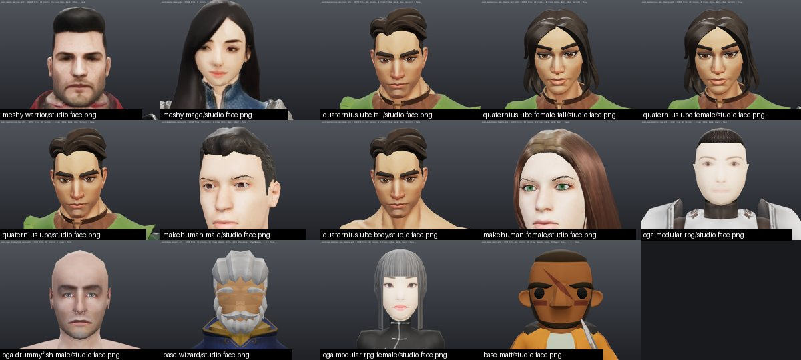

Fronts with the head rulers, same looks and order:

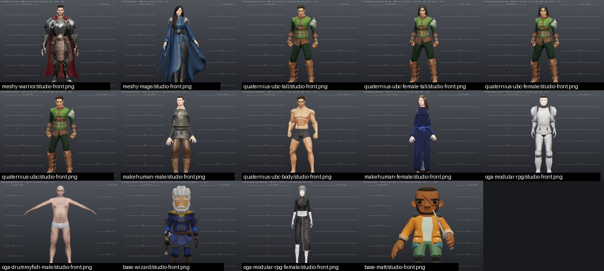

### One sheet per look

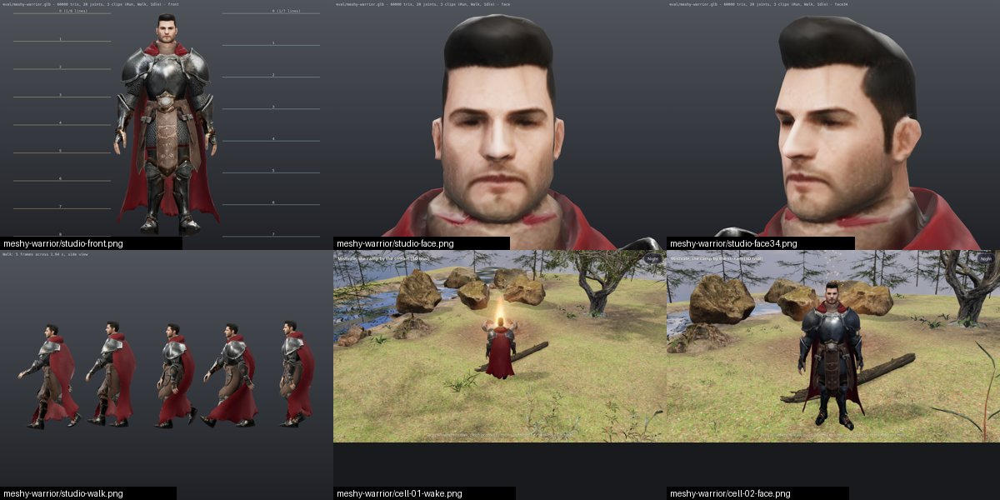

`meshy-warrior` - about 7.5 heads. Good: the closest match to the brief, with a believable stubbled adult face, layered steel plate over mail, a leather tabard, a long red cape and a natural Walk and Run. Wrong: the painted face is soft with half-shut eyes, red from the cape bleeds onto the neck, the hair is a solid shell, there is no gold trim, and the cape and apron are skinned to the thighs so they cut through the legs in Run.

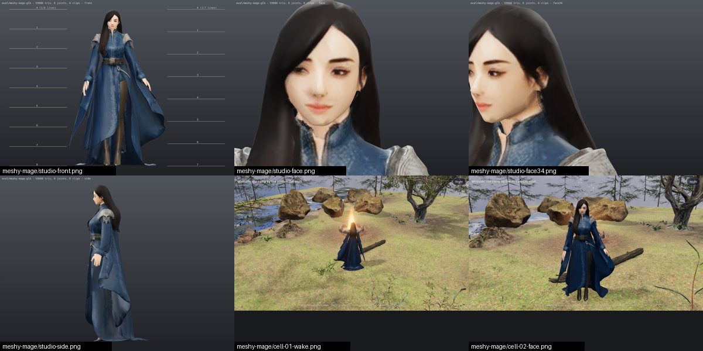

`meshy-mage` - about 8.2 heads. Good: the most on-style figure, an idealised young mage with long dark hair, a deep-blue robe with silver embroidery and ornate shoulders, at the same fidelity as the warrior. Wrong: a static mesh (the free plan refused the rig), a soft and slightly lopsided face close up, wide sleeves and hem flaps that will be hard to skin, and a dagger on the belt that was not asked for.

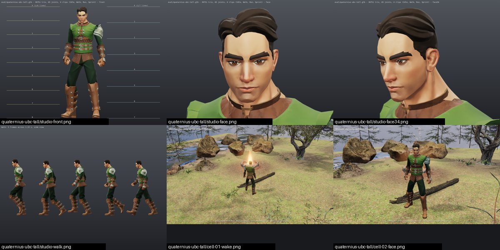

`quaternius-ubc-tall` - about 7.3 heads. Good: a clean stylised face, sculpted hair, the best motion of the set on a shared skeleton with fingers, and no seam at the neck after the head scale. Wrong: stylised rather than realistic, a ranger outfit instead of plate or robes, and 42 MB of PNG textures in the evaluated file.

`quaternius-ubc-female-tall` - about 7.4 heads. Good: the best female of the CC0 kit, with an appealing stylised face (winged liner, freckles), a real hair mesh and natural motion. Wrong: still stylised, still the plain ranger kit, and 41 MB in the evaluated file.

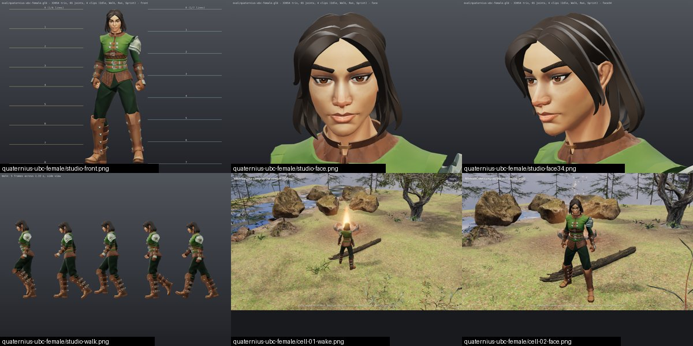

`quaternius-ubc-female` - about 7.1 heads. Good: the same clean face, hair and motion as the tall cut. Wrong: short proportions for the target, a stylised face and the ranger kit.

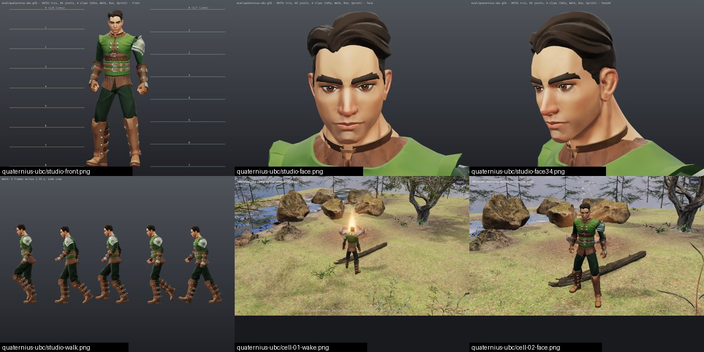

`quaternius-ubc` - about 6.9 heads. Good: a polished kit with the cleanest motion and one skeleton for a whole cast. Wrong: the head is too big for the target, the face is stylised, and the green ranger outfit is not ornate armour.

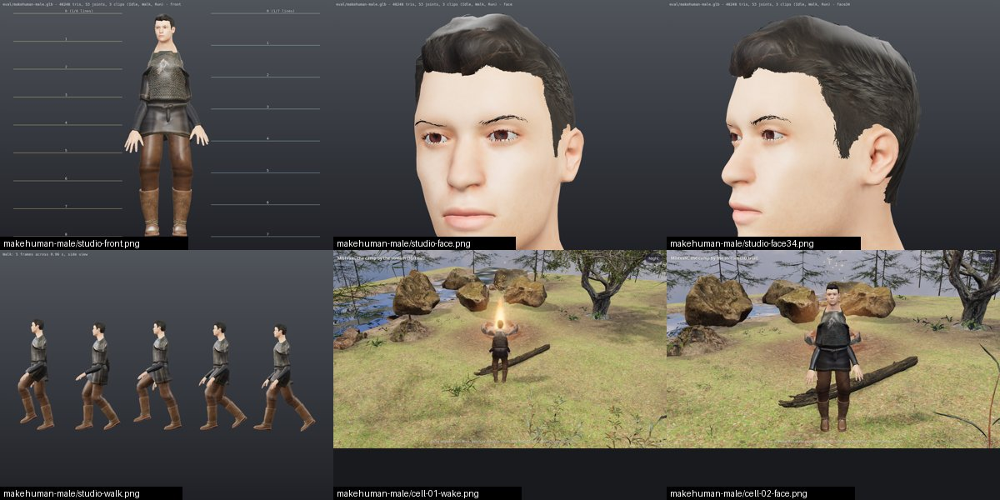

`makehuman-male` - about 8 heads. Good: the most anatomically complete face (modelled eyes, lids, lips, ears) on a true 8-head body. Wrong: generic rather than heroic, a hard-cut helmet-like hairline, a plain commoner tunic, a marching Walk and a straight-armed Run from the robot clips, a skirt that splits between the legs, and 21 MB of PNG textures.

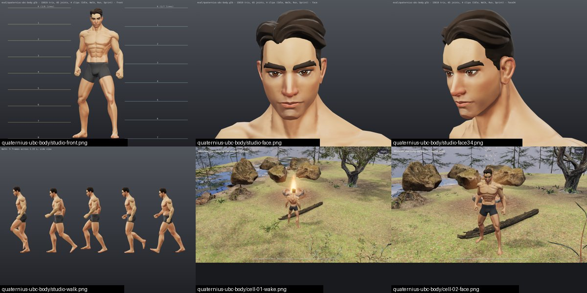

`quaternius-ubc-body` - about 6.9 heads. Good: a heroic muscular base that deforms cleanly at the shoulders, hips and knees in Run. Wrong: an unclothed base in briefs, a body for outfits rather than a look.

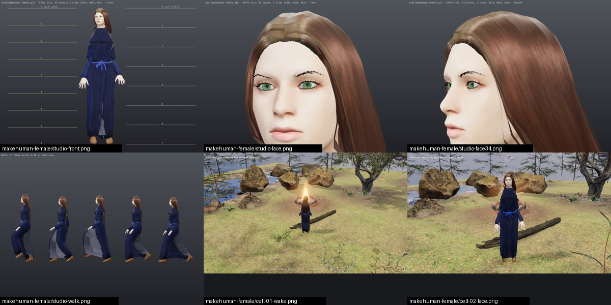

`makehuman-female` - about 8.1 heads. Good: a believable young face with green eyes. Wrong: drawn-on brows, a faceted low-poly hair cap with the scalp showing, and a plain monk robe that stretches into a pale sheet between the legs in Walk and Run, the worst cloth deformation in the set.

`hunyuan-warrior` - about 7.8 heads (the scarf hides the chin). Good: the best paladin costume of the set (gold-trimmed plate, red tabard with an emblem, red cape) and the strongest silhouette from behind. Wrong: a smeared one-eyed mask for a face, upper arms fused into the pauldrons, stiff procedural clips with cape tatters between the legs in Run, and the cape chain parented to the head bone.

`tripo-mage` - about 8.8 heads. Good: the most ornate robe of the set (layered deep blue with silver embroidery, a high collar, shoulder pieces). Wrong: a doubled, smeared face with blue bleeding across the jaw, a stray staff line to the floor, a T-pose, and an exported rig with no joint transforms and no clips.

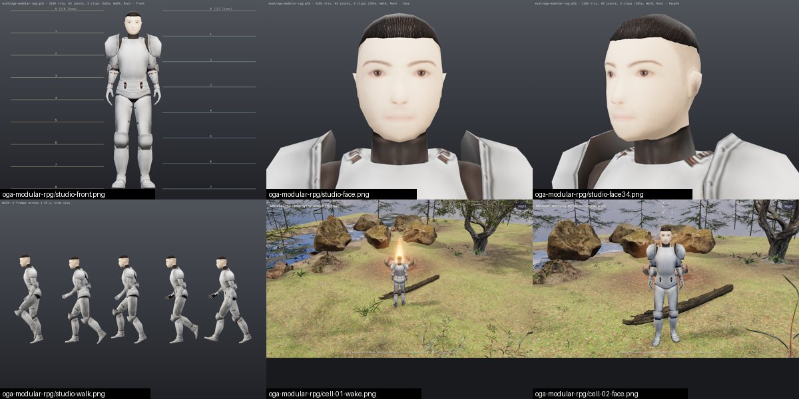

`oga-modular-rpg` - about 7.5 heads. Good: light (1.7 MB, 3k triangles), drop-in, with working clips and a knightly silhouette. Wrong: plain white plate that reads as dated toy armour, a flat painted mask for a face, cap-like hair and hurried 0.79 s Idle and Run loops.

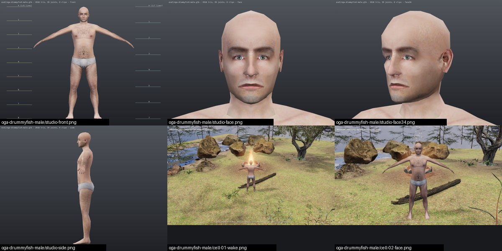

`oga-drummyfish-male` - about 7.1 heads. Good: realistic proportions and a photo-based face that reads as a real adult. Wrong: a bald 2k-triangle base mesh in underwear, faceted and blurry close up, with no clips, so it slides in A-pose in the cell.

`tripo-warrior` - about 8.4 heads. Good: silver plate with crossed straps and a belt reads as armour from a distance. Wrong: a smeared face with an eye and a red smear on the forehead, a stray stick to the floor, no cape, a T-pose, and an exported rig with every joint at the origin and no clips.

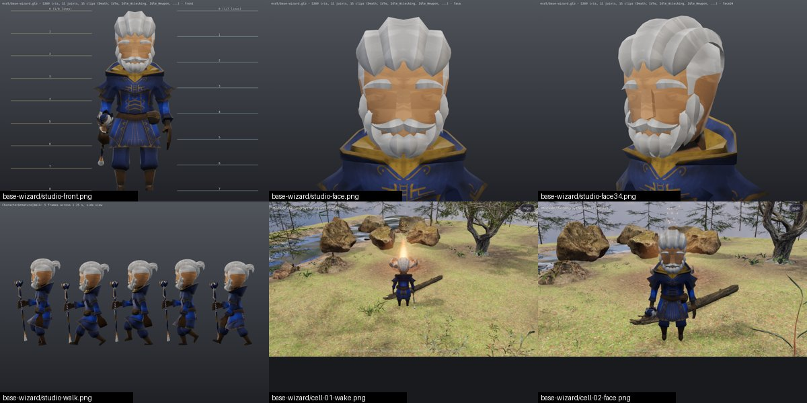

`base-wizard` - about 3 heads. Good: already in the game, clean, with 15 tidy clips and a blue-and-gold robe in the right colour family. Wrong: a chibi with a blocky faceted toy face and slit eyes, outside the target.

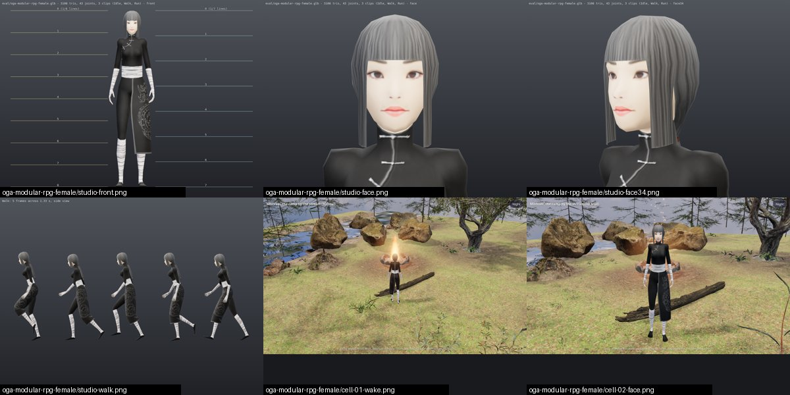

`oga-modular-rpg-female` - about 7.8 heads. Good: fine clips and a light file. Wrong: a flat painted face on 3k triangles and a black high-collar outfit with bandaged limbs that reads as eastern rather than classic western high fantasy.

`hunyuan-mage-shape` - about 7.6 heads with the hood. Good: an elegant hooded robe silhouette with bell sleeves and shoulder pieces. Wrong: untextured and unrigged, a stair-stepped face with no eyes, and a floor-length train that will fight any leg skinning.

`hunyuan-warrior-shape` - about 7.4 heads. Good: plate, belt, mail skirt and boots read in silhouette. Wrong: untextured and unrigged, a faceted face with dents for eyes, arms fused into the pauldrons and a one-sheet cape; it has no cell capture.

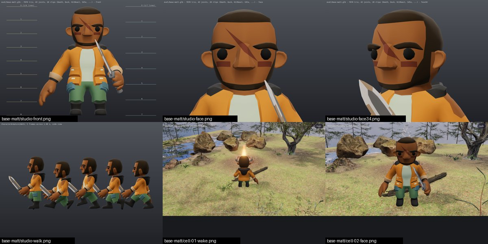

`base-matt` - about 2.8 heads. Good: the technical yardstick (7k triangles, one 512 px texture, 0.64 MB, 20 clean clips) and already in the game. Wrong: a modern casual chibi with a toy face, the opposite of the brief.

## Blocked or partial routes

**Meshy (done; the mage was rigged locally later the same day, see the addendum at the end).**
- Auto-rig for the mage: the raw mesh (322,614 faces) forced a remesh, and rigging a remeshed
  model is a Pro feature (the warrior, at 191,496 faces, rigged free without a remesh). Unblock:
  the Pro plan at https://www.meshy.ai/pricing, or regenerate the mage with a simpler silhouette
  so the raw mesh stays under the rig's face limit.
- The A-pose / T-pose option is paid, so the pose came from the prompt alone and the arms sit
  15-20 degrees from the body instead of 45. Unblock: a paid plan at https://www.meshy.ai/pricing.
- A custom remesh polycount (for example 30k) is Pro. Unblock: https://www.meshy.ai/pricing.
- The free plan downloads only Meshy 6 Lite models (10 a month), not Meshy 6 or 7.1, and its
  output is Meshy's, licensed CC BY 4.0. Unblock: the Pro plan at https://www.meshy.ai/pricing.
- The free Idle preset failed three times with "status: 400" (the Idle 1-5 presets are paid).
  Worked around: the Idle clip came from Text to Motion (10 credits) at
  https://www.meshy.ai/workspace?sidebar=animate.

**Tripo (partial; evaluation only).**
- API route: the API wallet holds 0 credits and there are no free API credits. Unblock: top up
  with "Add to credit balance" at https://platform.tripo3d.ai/billing (a payment; the page lists
  text-to-3D with texture at 40 credits, rigging 25, retarget 10 per animation).
- Export of the H3.1 warrior, the best-looking result of the route in Tripo's own viewer: the free
  plan exports H2.5 models only and shows an upgrade wall. Unblock: a paid Studio plan, then
  Export at https://studio.tripo3d.ai/workspace/generate/70d4e866-c9d8-4fd3-b1ca-3691699d5b32 (the
  model is already generated).
- Skeleton and clips in the export: "Export Skeleton" is for subscribers, so the free export has
  no clips and its joints have no transforms. Unblock: a paid Studio plan, then export with
  skeleton and animations at
  https://studio.tripo3d.ai/workspace/animate/8cb948fb-0f64-4048-93a1-d63471ba9b43 (warrior) or
  https://studio.tripo3d.ai/workspace/animate/e423faba-cf8e-463b-a103-a9320c0b353c (mage).
- The licence: free outputs belong to Tripo and the free plan is non-commercial, so nothing from
  this route may enter the repository unless it is made again on a paid plan.

**Hunyuan3D on Hugging Face (partial; evaluation only).**
- Textured generation on the Hunyuan3D-2 Space fails (a Space-side NameError; its texture
  painter is hidden), so only shapes come out there. Unblock: nothing to click; use the
  Hunyuan3D-2.1 Space at https://huggingface.co/spaces/tencent/Hunyuan3D-2.1, as
  `hunyuan-warrior` did.
- A textured mage and any further textured run: the free GPU quota is 300 s a day and one
  textured Hunyuan3D-2.1 run asks for 270 s, so the mage run was refused (at no charge). Unblock:
  run it again after the daily quota resets, or Hugging Face PRO at
  https://huggingface.co/subscribe/pro (paid).
- The cell trial of `hunyuan-warrior-shape` was not captured; for a grey, unrigged,
  evaluation-only shape it is not worth a re-run.
- The licence: the Territory excludes the EU, the UK and South Korea, so no output of this
  route can ship in a game anyone in the world can open. No setting unblocks that.

**Mixamo (not run).**
- Auto-rig and three or four clips for the best static AI meshes (the Meshy mage, and the
  Hunyuan warrior for comparison): the Mixamo auto-rigger needs a visible, rendering browser
  window to place its markers, and none was available during the run. Unblock: upload the static
  mesh at https://www.mixamo.com from a browser window that stays visible for the whole rig. Its
  output may not sit in this repository either way (see the licences below), so this is an
  evaluation step.

**MakeHuman (done, with a stand-in clip source).**
- The planned clips, the Quaternius Universal Animation Library: its download button opened the
  itch.io pay-what-you-want checkout, where this route stopped, so the clips were retargeted
  from the CC0 RobotExpressive model instead and look cartoonish. Unblock: at
  https://quaternius.itch.io/universal-animation-library click "Download Now", then "No thanks,
  just take me to the downloads" (the free tier, CC0; the Quaternius looks above already use it),
  and retarget its Idle, Walk and Run onto the MakeHuman skeleton, whose mannequin-style bone
  names map almost 1:1.

**Quaternius paid tiers (the CC0 kit).**
- The knight and wizard outfits of Modular Character Outfits - Fantasy and the extra base bodies
  are in the paid Source tiers, listed at $20 (the outfits) and $19.99 (the base bodies). Unblock:
  buy at https://quaternius.itch.io/modular-character-outfits-fantasy (and
  https://quaternius.itch.io/universal-base-characters). The outfits share the skeleton, so a
  knight or mage look rebuilds in seconds with the clips and the head scale.

## Licences

### Meshy (`meshy-warrior`, `meshy-mage`, `wolf-bright`, `wolf-grim`)

[Meshy Terms of Use](https://www.meshy.ai/terms-of-use), section 3.2 (Last Updated September 19,
2026):

> "Customers using Meshy's Services under the free plan, acknowledge and agree that Meshy owns all
> right, title, and interest, including all intellectual property rights, in and to the Customer
> Output and makes such rights available to free plan customers under the Creative Commons
> Attribution 4.0 International License (the "CC BY 4.0 License"), as long as the free plan
> customer provides appropriate credit to Meshy. For more information about the CC BY 4.0 License,
> please see https://creativecommons.org/licenses/by/4.0/."

Commercial use is allowed with the credit. Section 2.9 lets Meshy train on free-plan inputs and
outputs; on a paid plan the customer owns the output. Bone names follow the mixamorig convention
of Meshy's skeleton template; no Mixamo content is in the files.

### Quaternius on itch.io (`quaternius-ubc*`)

Licence files in the zips (License_Standard.txt in Universal Base Characters and Modular Character
Outfits - Fantasy, License.txt in Universal Animation Library):

> "License: CC0 1.0 Universal (CC0 1.0) Public Domain Dedication https://creativecommons.org/publicdomain/zero/1.0/"

The pages [universal-base-characters](https://quaternius.itch.io/universal-base-characters),
[modular-character-outfits-fantasy](https://quaternius.itch.io/modular-character-outfits-fantasy)
and [universal-animation-library](https://quaternius.itch.io/universal-animation-library) each
say:

> "Free to use in personal, educational and commercial projects. (CC0 License)" and "Asset license
> Creative Commons Zero v1.0 Universal"

Caveat: https://quaternius.com/license.html now shows "Quaternius Asset License (QAL) v1.0, Last
updated: 8/28/2026" ("You just can not resell or redistribute the assets themselves as assets").
The three packs and their zips still state CC0; give it a one-line check before shipping.

### Quaternius on Poly Pizza (the two characters already in the cell trial)

- `character-matt.glb` is "Characters Matt" by Quaternius, https://poly.pizza/m/66kQ4dBBC7,
  licence field "Public Domain (CC0)" ([CC0 1.0](https://creativecommons.org/publicdomain/zero/1.0/)).
  No attribution is required.
- `character-wizard.glb` is byte-identical (SHA-256) to "Animated Wizard" by Quaternius,
  https://poly.pizza/m/kttbFvCl2C, licensed "Creative Commons Attribution"
  ([CC BY 3.0](https://creativecommons.org/licenses/by/3.0/)). Attribution is required. The models
  README called both files CC0; its sentence is corrected.

### MakeHuman / MPFB (`makehuman-male`, `makehuman-female`)

[FAQ](https://static.makehumancommunity.org/makehuman/faq/are_makehuman_files_free.html):

> "Yes. The asset license is CC0. In practice this imposes no restriction on your use of the core
> assets, be they used through MakeHuman or copied through some other means."

[LICENSE.md](https://github.com/makehumancommunity/makehuman/blob/master/LICENSE.md):

> "These assets have been released under CC0 1.0 Universal." / "As the assets have been released
> under CC0, there is no limitation on what you can do with this combined output." / "To make it
> clear, the MakeHuman project makes no claim whatsoever over output such as: * Exports to files
> (FBX, OBJ, DAE, MHX2...)"

Every asset used is CC0 on the
[asset packs page](http://static.makehumancommunity.org/assets/assetpacks.html) (hair by
culturalibre; viking tunic, trousers and boots by RehmanPolanski; monk robe by Donitz; ankle boots
by MargaretToigo). The clips come from RobotExpressive by Tomas Laulhe (Quaternius) in the
[three.js examples](https://github.com/mrdoob/three.js/tree/dev/examples/models/gltf/RobotExpressive),
whose README says "Before using this model on a project, consider supporting the creator's
Patreon. CC0 1.0." MPFB's own code is GPL-3.0, but it is only the tool and none of it is in the
files.

### OpenGameArt (`oga-*`)

- [Modular RPG Characters](https://opengameart.org/content/modular-rpg-characters): "License(s):
  CC0" and "Copyright/Attribution Notice: You don't need to credit me, but if you like you can
  mention me as System G6 or Qoma."
- [3D male](https://opengameart.org/content/3d-male-0): "License(s): CC0" and
  "Copyright/Attribution Notice: no need, if you want credit drummyfish".
- The retargeted walk comes from the Quaternius Universal Animation Library (CC0, above).

### Tencent Hunyuan 3D 2.0 and 2.1 (`hunyuan-*`, evaluation only)

[Tencent Hunyuan 3D 2.1 Community License](https://huggingface.co/tencent/Hunyuan3D-2.1/blob/main/LICENSE):

> "THIS LICENSE AGREEMENT DOES NOT APPLY IN THE EUROPEAN UNION, UNITED KINGDOM AND SOUTH KOREA AND
> IS EXPRESSLY LIMITED TO THE TERRITORY, AS DEFINED BELOW."
>
> ""Territory" shall mean the worldwide territory, excluding the territory of the European Union,
> United Kingdom and South Korea."
>
> "You must not use, reproduce, modify, distribute, or display the Tencent Hunyuan 3D 2.1 Works,
> Output or results of the Tencent Hunyuan 3D 2.1 Works outside the Territory. Any such use outside
> the Territory is unlicensed and unauthorized under this Agreement."
>
> "Tencent claims no rights in Outputs You generate. You and Your users are solely responsible for
> Outputs and their subsequent uses."

The [Tencent Hunyuan 3D 2.0 Community License](https://huggingface.co/tencent/Hunyuan3D-2/blob/main/LICENSE)
has the same clauses for "Tencent Hunyuan 3D 2.0". Distribution also needs Tencent's Notice file,
and a product with more than 1 million monthly active users needs a separate licence. The tools
around it are fine: the concept images came from
[FLUX.1-schnell](https://huggingface.co/black-forest-labs/FLUX.1-schnell) ("Released under the
`apache-2.0` licence, the model can be used for personal, scientific, and commercial purposes.")
and the rig from UniRig (MIT: [code](https://github.com/VAST-AI-Research/UniRig/blob/main/LICENSE),
[weights](https://huggingface.co/VAST-AI/UniRig)).

### Tripo (`tripo-*`, evaluation only)

[Tripo Terms of Service](https://www.tripo3d.ai/terms) (Last updated: July 11, 2025), 5.2.1 Users
Free of Charge:

> "For Users who access and use the Services free of charge ("Free Users"), Tripo retains all
> rights, including without limitation the rights to use, copy, reproduce, modify, adapt, publish,
> translate, create derivative works from, distribute, promote, transfer, authorize, license,
> optimize, derive revenue or other remuneration from, communicate to the public, perform, and
> display the Inputs and Outputs submitted or generated by Free Users, as well as all Intellectual
> Property rights arising therefrom."

The [pricing page](https://www.tripo3d.ai/pricing) lists the free plan as "Public Models" and
"Non-Commercial Use". No attribution line can make these files eligible.

### Mixamo

No Mixamo file was made. Adobe's terms allow Mixamo characters and clips inside a shipped game but
not as stand-alone files, so they never go into this repository (details and links in
[character-sources.md](character-sources.md)).

### What may sit in this repository

| File | Licence | Attribution it needs |
|---|---|---|
| `game/public/3d/models/character-meshy-warrior.glb` (added) | CC BY 4.0 | "Warrior, generated with Meshy (meshy.ai), CC BY 4.0, https://creativecommons.org/licenses/by/4.0/; modified: reduced from 191,496 to 60,000 triangles, clips renamed to Idle, Walk and Run, a 0.08 s extra clip removed" |
| `game/public/3d/models/character-meshy-mage.glb` (added) | CC BY 4.0 | "Mage, generated with Meshy (meshy.ai), CC BY 4.0, https://creativecommons.org/licenses/by/4.0/; modified: reduced from 322,614 to 59,988 triangles; skeleton and skin weights added in Blender by transferring the warrior's Mixamo-named rig (game/tools/blender/rig_transfer.py); clips Idle, Walk and Run shared from the warrior" |
| `game/public/3d/models/character-wizard.glb` | CC BY 3.0 | "Animated Wizard" by Quaternius, https://poly.pizza/m/kttbFvCl2C, CC BY 3.0 |
| `game/public/3d/models/character-matt.glb` | CC0 | none |
| The Quaternius looks (not added; use the 1024 px WebP builds of about 3 MB) | CC0 | none (optional: "Character parts and animations by Quaternius (CC0)"); check the QAL note above |
| The MakeHuman looks (not added; compress the 21-22 MB of PNG first) | CC0 | none (optional courtesy line naming the asset authors above) |
| The OpenGameArt looks (not added) | CC0 | none (optional: System G6 / Qoma, drummyfish) |
| `docs/3d/img/*.jpg` without the `eval-only-` prefix | screenshots of the CC0 and CC BY looks above | the credit of the look shown (Meshy CC BY 4.0, Animated Wizard CC BY 3.0) |
| Anything from Hunyuan, Tripo's free plan or Mixamo | not allowed | none can make them eligible; the seven evaluation-only screenshots and the Tripo and Hunyuan evaluation files were deleted before the first commit, so only their written assessments remain in this document |

The two added GLBs are the eligible looks with the best median face + style (both 7.5; the warrior
first on the technical score). `character-meshy-warrior.glb` is rigged with Idle, Walk and Run;
`character-meshy-mage.glb` was static at review time and now carries the warrior's skeleton and
clips (addendum). Both load in the cell
trial with `?look=meshy-warrior` and `?look=meshy-mage`.

Raw AI output is generally not protected by copyright: under the US Copyright Office guidance and
Thaler v. Perlmutter (see rule 11 in [character-sources.md](character-sources.md)), a mesh or
texture generated without human authorship has no author. Whatever label it carries, an unedited
Meshy mesh is therefore not the project's own work; only hand-edited layers (re-weighted skinning,
repainted textures, re-sculpted anatomy, the project's own concept art fed in) would be. Keeping
Meshy's credit costs nothing and follows its terms.

## Recommendation

Continue the **Meshy** route, with `meshy-warrior` as the template. All three reviews rank it
first: it is the only route that delivered the whole brief as one repository-eligible GLB on a
free plan, with a realistic adult face, layered plate in the target style, about 7.5 heads, and a
Mixamo-named skeleton with a natural Walk, Run and Idle at 4.3 MB. `meshy-mage` shows the same
route can make the robed hero at the same fidelity, so a cast made from one style prompt would
read as one game and could share one clip library. The Quaternius kit moves best (Animation 5)
and shares one 65-joint skeleton with fingers across the kit, but its faces are stylised and its
free outfits are rangers, so it is the fallback only if the direction turns stylised.

Next three steps:

1. Direction check, on the one month of Meshy Pro recommended below (the A-pose option, downloads
   of the full Meshy 6 model and rigging a remeshed model are not on the free plan): from one fixed
   style prompt, with the A-pose option on and on the full Meshy 6 model, generate a matched trio
   (the warrior again with gold trim and open eyes asked for, the mage, and one townsperson), rig
   all three on the same skeleton, drive them with one shared Idle, Walk and Run set, and put the
   three stills in front of the owner.
2. Cloth: move the cape and tabard weights off the thighs onto the pelvis and spine plus a two- or
   three-bone cape chain (or a spring chain driven in Three.js) so they stop cutting through the
   legs in Run, and check the mage's sleeves and hem the same way.
3. Game-ready pass: paint over the face texture (sharper eyes and brows, no red bleed at the neck)
   and check it at the closest cell zoom; bring the mesh to about 40k triangles and compress the
   three maps (KTX2 or 1024 px WebP); confirm 7.5-8 heads (a head scale of about 0.95 if short);
   and play a second character on the same clips in the cell trial to prove clip sharing.

### Would a subscription pay off?

**Yes: one month of Meshy Pro, $20 a month ($10 the first month) on
https://www.meshy.ai/pricing**, with 1,000 credits a month and unlimited downloads. It removes the exact walls this
route hit on the free plan: downloads of the full Meshy 6 and 7.1 models instead of Meshy 6 Lite
only (the soft face and the solid-shell hair are the weakest parts of the Lite output; the full
models should help, though that is not yet tested), the A-pose option (the free mesh holds its
arms 15-20 degrees from the body, which makes shoulder skinning fragile), auto-rig for remeshed
models (what stopped the mage), a custom remesh polycount (assets land near 40k directly), and a
private licence instead of CC BY 4.0. At about 100 s per textured model, one month covers
generating and re-rolling the whole hero cast. Without it, the free plan still has 80 credits and
6 downloads this month: 20 credits and one download per textured Lite character, with free
rigging while the raw mesh stays under the rig's face limit.

Not now: Tripo's paid Studio plan (Pro $20 a month, or $13 a month billed yearly) - its H3.1
preview is the best-looking knight in the material, but it is only a render in Tripo's own
viewer, and the free export gave smeared faces and a rig with no joint transforms, so buy a month
only as a comparison if Meshy's full models do not fix the face. Hugging Face PRO buys nothing
shippable, because the Hunyuan licence excludes the EU, the UK and South Korea. The Quaternius
paid Source tiers ($20 for the outfits, $19.99 for the base bodies) would complete a consistent
stylised cast, not the realistic target.

### Where the reviews differ

All three reviews pick the Meshy route and one month of Meshy Pro, and they differ in four places:
the art director would put the matched trio in front of the owner before any cleanup, the
character artist would first regenerate the warrior and the mage on the full model, and the
technical artist would first clean up the existing warrior (the steps above follow the art
director, because direction comes before polish); two of them rank `quaternius-ubc-tall` second
where the art director ranks `meshy-mage` second; the character artist and the art director would
try a month of Tripo if Meshy's faces stay soft, where the technical artist says not yet; and they
read the warrior at 7.1, 7.5 and 7.9 heads.

## Addendum, later the same day: the mage rigged locally, the warrior's cloth re-weighted

Two Blender 4.5 scripts, now in `game/tools/blender/`, do the work that the free plan refused:

- `rig_transfer.py <rigged.glb> <static.glb> <out.glb> [--skirt]` gives a static character the
  skeleton and clips of an already rigged one. It fits the skeleton by its bone span (feet on
  the floor, centred), tries Blender's bone-heat weights (they fail on generated meshes, which
  are open shells), falls back to smoothed nearest-bone weights, and with `--skirt` blends a
  long robe between the two thighs and the hips so it stretches instead of tearing. On the
  mage: 59,982 triangles, 28 joints, Idle, Walk and Run shared from the warrior, 3.6 MB. The
  walk reads well from the side; in Run the robe panels flap because the generated robe is
  several overlapping shells, and a boot shows through the hem in some frames. The file
  replaced `character-meshy-mage.glb`; the scores table above still shows the review-time
  state (static).
- `cape_fix.py <rigged.glb> <out.glb>` finds the cloth by the red of the base colour texture,
  and moves cape vertices that followed a leg to the hips, tabard vertices halfway. Result:
  partial. The body is untouched and the cape hangs behind as one piece, but its hem tears in two of five run frames where red and darker cape vertices meet. The repository keeps the original warrior until a pass that grows the selection over the connected cloth shell and smooths the weights across its boundary.

Both outputs are hand-edited layers on top of the generated meshes and keep the Meshy credit
line. Next for cloth: a two-bone cape chain driven by the run cycle, and sleeve weights for
the mage.

## Addendum, 2026-10-09: the two wolves walk on four legs

The two wolf drafts (`wolf-bright`, `wolf-grim`) were rigged in Meshy with the Quadruped Dog
template, one free rig per account, and passed through `game/tools/blender/quad_pass.py`:

- Input is the `..._Animation_Walking_withSkin.glb` of the rig download. The script scales it to
  0.9 m at the ears, turns it to face +Z, puts the textured draft's maps back (a rig of an
  uploaded mesh comes without them; the UV layout is the same), drops the emission input (a rig
  of a Meshy asset wires the colour map to emission as well, and the wolf glowed at night), and
  cuts the maps to 1024 px.
- Clips: Meshy's walk, the only motion in the free four-legged library, renamed Walk; Run made
  from the walk at 1.8 times the tempo, with the leg swing 1.5 times wider and a small lift of
  the hips; Idle made from the standing pose (6 s of breathing, a slow look around with the
  chest and head, and a tail sway). Walk and Run store `groundSpeed` in the clip extras: metres
  per second at the file's size, measured on the planted feet.
- `game/src/cell3d/main.ts` recognises a four-legged character by its `frontleg` bones and gives
  it 0.95 m at the ears, 1.1 m/s walking and 2.8 m/s running, a lower camera target and a long
  shadow. Every character can now run: Shift, or the thumb pulled past the ring. A clip with
  `groundSpeed` plays at the rate that keeps the planted feet still (about 1.7 for both gaits of
  the grim wolf, about 1.5 for the bright one).
- Result: 49,993 and 51,749 triangles, 2.4 and 2.2 MB, Idle, Walk and Run in the cell trial at
  desktop and phone size, by day and at night. On an integrated GPU, in a 1236x800 window at
  device scale 2, the camp drew 32 to 34 frames per second by day and 19 to 22 at night with a
  wolf in it.
- Limit: Run is a quickened walk, a fast trot rather than a gallop, because the free library has
  no other four-legged motion. A real gallop needs a paid motion or a hand-keyed cycle.
